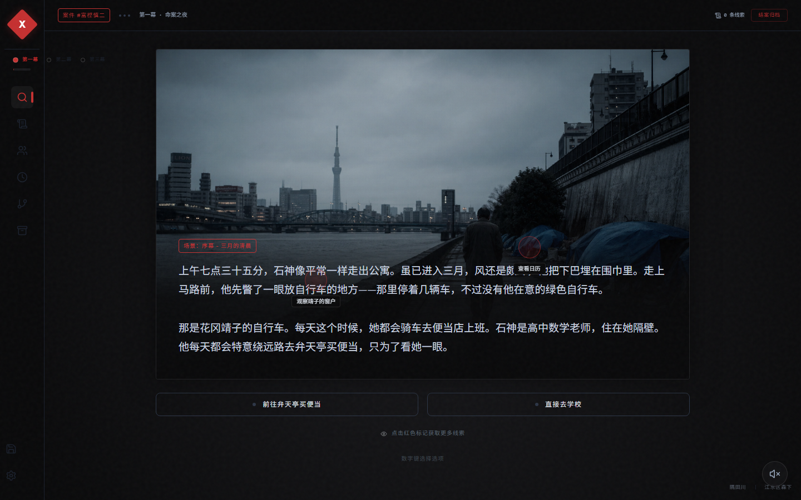
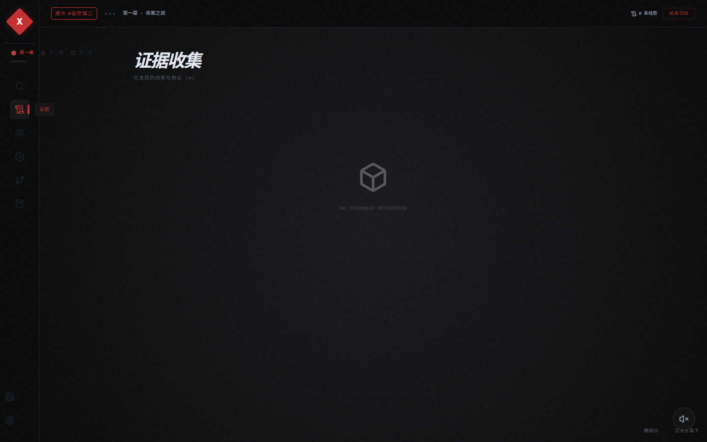
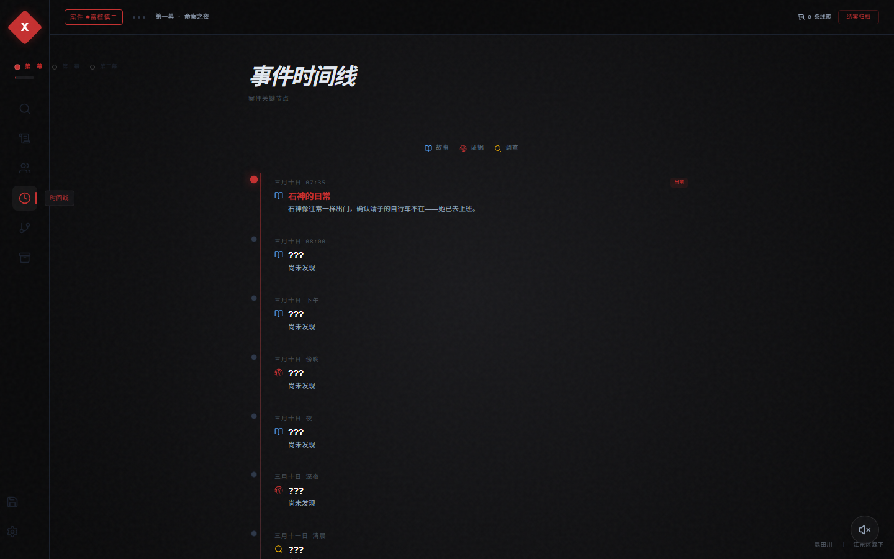
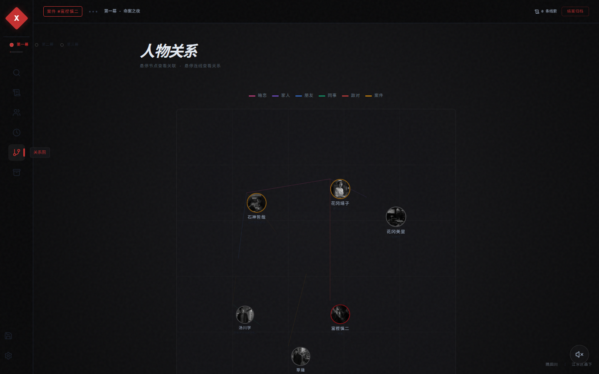

# Suspect X Explorer / 嫌疑人X探索者

[English](#english) | [中文](#中文)

---

<a name="english"></a>
## English

An interactive detective experience based on Keigo Higashino's masterpiece *The Devotion of Suspect X*. Explore the case, examine evidence, interrogate suspects, and uncover the truth behind the perfect alibi.

### Live Demo

- GitHub Pages: https://ballcard.github.io/suspect-x-explorer/
- China-friendly mirror: https://pp7p3d2q8r.coze.site

If the in-app browser loads slowly, copy the link and open it in a regular browser.


### Features

**Interactive Narrative**
- 44 story scenes across 3 acts with branching choices
- Typewriter text effect with skip (click / space / enter)
- Keyboard navigation (1-9 to select choices)



**Detective Tools**
- **Evidence Board** — Collect and review clues discovered through exploration
- **Suspect Dossier** — View profiles, alibis, and mark suspects as guilty / innocent
- **Timeline** — Track events chronologically, jump to any visited scene
- **Relationship Map** — Visualize connections between characters






**Atmosphere**
- 60 AI-generated scene illustrations
- Rain and fog effects for key moments
- Noir detective aesthetic

### Tech Stack

React · TypeScript · Vite · Framer Motion · Tailwind CSS

### Getting Started

```bash
npm install
npm run dev
```

Open http://localhost:3000 in your browser.

---

<a name="中文"></a>
## 中文

基于东野圭吾《嫌疑人X的献身》改编的交互式侦探体验。探索案件、收集证据、审问嫌疑人，揭开完美不在场证明背后的真相。

### 在线体验

- GitHub Pages: https://ballcard.github.io/suspect-x-explorer/
- 国内友好版: https://pp7p3d2q8r.coze.site

> 如果在微信内置浏览器中加载较慢，建议复制链接到系统浏览器打开。

### 功能特色

**交互叙事**
- 三幕共 44 个场景，含分支选择
- 打字机效果，支持点击/空格/回车跳过
- 键盘导航（数字键 1-9 快速选择）

**侦探工具**
- **证据板** — 收集并查看探索中发现的线索
- **嫌疑人档案** — 查看人物资料、不在场证明，标记嫌疑人状态
- **时间线** — 按时间顺序追踪事件，跳转任意已访问场景
- **关系图** — 可视化人物之间的关联

**氛围营造**
- 60 张 AI 生成的场景配图
- 关键时刻的雨雾特效
- 黑色侦探美学风格

### 技术栈

React · TypeScript · Vite · Framer Motion · Tailwind CSS

### 快速开始

```bash
npm install
npm run dev
```

浏览器打开 http://localhost:3000

---

## License

This is a fan-made educational project. *The Devotion of Suspect X* is copyrighted by Keigo Higashino.
